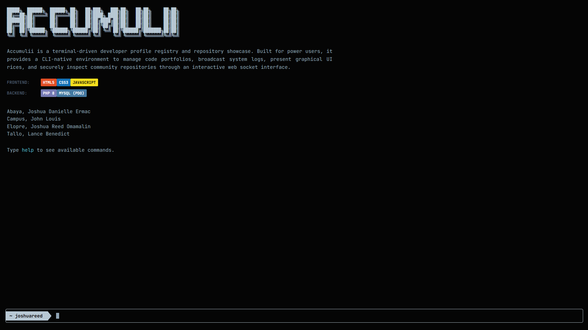

# Accumulii

A terminal-style developer profile registry and repository showcase.



## Course Information

| | |
| :--- | :--- |
| Course | Web Development I |
| Program | Information Technology, 2nd Year |

## Team

This project was developed by four students:

- Joshua Reed Omamalin Elopre
- Lance Benedict Tallo
- John Louis Campus
- Joshua Danielle Ermac Abaya

## Overview

Accumulii is a web application with a command-line interface that runs in the browser. Users create an account and type commands to edit a profile, post to a public log, search and compare repositories, and view showcase images such as desktop setups.

The project uses PHP and MySQL on the backend and plain HTML, CSS, and JavaScript on the frontend.

## Objectives

- Build a database-driven web application with user authentication and sessions.
- Design a relational schema for users, repositories, showcases, and log entries.
- Implement a command parser that sends requests to a single PHP endpoint.
- Build a frontend that works through typed commands rather than menus and buttons.

## Features

- Login and registration with PHP sessions
- Editable profiles (bio, university, course, year)
- Public message log
- Repository listing, search, and side-by-side comparison
- Image showcases with details
- Three themes: dark, ash, and white

## Tech Stack

| Layer | Technology |
| :--- | :--- |
| Frontend | HTML5, CSS3, JavaScript |
| Backend | PHP 8 |
| Database | MySQL via PDO |
| Font | JetBrains Mono (Google Fonts) |
| Local server | XAMPP (Apache and MySQL) |

## System Requirements

- XAMPP with Apache and MySQL (PHP 8 or later)
- A modern web browser
- An internet connection on first load, for the Google Fonts request

## Installation

1. **Start XAMPP.** Open the XAMPP Control Panel and start Apache and MySQL.

2. **Copy the project.** Place the `Accumulii/` folder in the XAMPP `htdocs` directory:

   ```
   C:\xampp\htdocs\Accumulii\                  (Windows)
   /Applications/XAMPP/htdocs/Accumulii/       (macOS)
   /opt/lampp/htdocs/Accumulii/                (Linux)
   ```

3. **Import the database.**
   1. Go to `http://localhost/phpmyadmin`.
   2. Create a database named `accumulii`.
   3. Select it, open the **Import** tab, choose `database.sql`, and click **Import**.

   This creates the tables and loads the sample data.

4. **Check the database settings.** Open `config.php` and confirm the credentials match your setup. The defaults work for a standard XAMPP install with no root password:

   ```php
   $host     = 'localhost';
   $dbname   = 'accumulii';
   $username = 'root';
   $password = '';
   ```

   If you set a MySQL root password, enter it here.

5. **Open the app.** Go to `http://localhost/accumulii/`. You will be redirected to the login page.

## Test Accounts

The sample data includes four accounts: `joshuareed`, `lancer`, `john`, and `joshuadan`. All use the password `password`.

To create a new account, type `register` at the login prompt.

These accounts are for local testing only. Change or remove them before hosting the project publicly.

## Usage

Type `help` in the terminal to list all commands.

### General

| Command | Description |
| :--- | :--- |
| `help` | Show the command reference |
| `clear` | Clear the terminal output |
| `whoami` | Show the current username |
| `logout` | End the session and return to the login page |
| `online` | Show users currently online |
| `theme <name>` | Change the theme: `dark`, `ash`, or `white` |

### Profile

| Command | Description |
| :--- | :--- |
| `fetchme` | Show project info and credits |
| `profile <user>` | Show a user's profile |
| `set <key> "<value>"` | Update a profile field. Allowed keys: `bio`, `university`, `course`, `year` |
| `restore defts` | Reset your bio and posts, and restore the default theme and education fields |

### Public log

| Command | Description |
| :--- | :--- |
| `post "<msg>"` | Add a message to the public log |
| `log` | View all entries in the public log |

### Repositories

| Command | Description |
| :--- | :--- |
| `repos` | List all repositories |
| `repos <user>` | List a specific user's repositories |
| `searchrepo <query>` | Search repository names and descriptions |
| `repo <name> [name2 ...]` | View one or more repositories side by side. Press `q` to download a clone stub, `Esc` to close |

### Showcases

| Command | Description |
| :--- | :--- |
| `showcases` | List all showcases |
| `showcase <name>` | View a showcase image at full size with its details |

## Project Structure

```
Accumulii/
├── css/
│   ├── style.css       # Layout, design tokens, and component styles
│   └── theme.css       # Theme overrides (dark, ash, white)
├── js/
│   ├── api.js          # Sends POST requests to api.php
│   └── commands.js     # Command parser, handlers, and repo keybinds
├── img/
│   ├── profiles/       # Profile images, named by username (e.g. joshuareed.jpg)
│   └── showcases/      # Images used by the showcases table
├── index.php           # Main terminal interface and keyboard input
├── login.php           # Login page with boot sequence
├── register.php        # Multi-step registration
├── api.php             # POST endpoint for all terminal commands
├── config.php          # Database connection, sessions, and auth helpers
└── database.sql        # Schema and sample data
```

## Database Schema

| Table | Purpose |
| :--- | :--- |
| `users` | Accounts, profile fields (bio, university, course, year), and theme preference |
| `repositories` | Repositories linked to a user: name, description, language, and stars |
| `profile_comments` | Entries in the public log |
| `showcases` | Showcase images linked to a user |

## Limitations

- The project is built for local use under XAMPP. It has not been configured or hardened for public hosting.
- Sample accounts share a default password.
